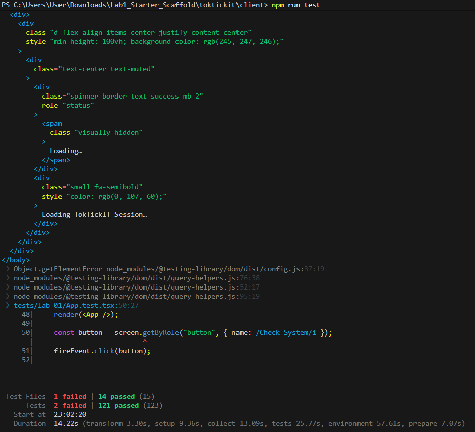

# Lab 4 — Peer Review Record

**Author:** Khanatip — 67070501008 — GitHub: [@Khanatip112](https://github.com/Khanatip112) \
**Peer reviewer:** Chetsada — 67070501080 — GitHub: [@JKNIGHTSX](https://github.com/JKNIGHTSX)

## Pull Requests I authored (reviewed by my partner)
| PR | Branch | Reviewer verdict |
|----|--------|------------------|
| https://github.com/Khanatip112/TokTickIT/pull/48 | feature/1-sprint4-contracts | Approved |
| https://github.com/Khanatip112/TokTickIT/pull/55 | feature/2-db-actions-taken | Approved |
| https://github.com/Khanatip112/TokTickIT/pull/57 | feature/3-actions-taken-api | Approved |
| https://github.com/Khanatip112/TokTickIT/pull/58 | feature/4-actions-taken-ui | Approved |
| https://github.com/Khanatip112/TokTickIT/pull/59 | feature/5-ticket-workflow | Approved |
| https://github.com/Khanatip112/TokTickIT/pull/60 | feature/6-requester-dashboard | Approved |
| https://github.com/Khanatip112/TokTickIT/pull/61 | feature/7-staff-dashboard | Approved |
| https://github.com/Khanatip112/TokTickIT/pull/62 | feature/8-e2e-screenshots | Approved |

**PR https://github.com/Khanatip112/TokTickIT/pull/48** 

> Reviewer comment (JKNIGHTSX) Nice Start!

> How I responded: Haha okay JK

**PR https://github.com/Khanatip112/TokTickIT/pull/55** 

> Reviewer comment (JKNIGHTSX) I received: Approve good to go you can merge it.

> How I responded: Thank JK, anyway, how's the reading going, JK lol

**PR https://github.com/Khanatip112/TokTickIT/pull/57** 

> Reviewer comment (JKNIGHTSX) I received: It look good. NEXT!

> How I responded: Thanks, JK I was worried about running out of tokens, so I rushed it.

**PR https://github.com/Khanatip112/TokTickIT/pull/58** 

> Reviewer comment (JKNIGHTSX) I received: It work well you can do the next issue..

> How I responded: Thanks for checking it. Let's keep rolling

**PR https://github.com/Khanatip112/TokTickIT/pull/59** 

> Reviewer comment (JKNIGHTSX) I received: isn't it should have at least one action taken to resolve ticket?

> How I responded: Let me check it out. Thanks, JK

> Rviewer comment (JKNIGHTSX) Nice Fix.

> How I responded: My mistake was not checking the 'action taken' for tickets with a 'new' status. lol

**PR https://github.com/Khanatip112/TokTickIT/pull/60** 

> Reviewer comment (JKNIGHTSX) I received: You nail it.Your can merge it now.

> How I responded: thanks for check JK

**PR https://github.com/Khanatip112/TokTickIT/pull/61** 

> Reviewer comment (JKNIGHTSX) I received:Nice work Khanatip.

> How I responded: Thank for check jk.

**PR https://github.com/Khanatip112/TokTickIT/pull/62** 

> Reviewer comment (JKNIGHTSX) I received: APPROVE! You have done it all.

> How I responded:Thanks a lot for checking it for me, JK It’s finally done, but I still have to do the report TT

## Pull Requests I reviewed for my partner

**PR https://github.com/JKNIGHTSX/toktickit/pull/58**

> My comment: All files are okay. Anyway, are you going to study for the exam

> Partner's response (JKNIGHTSX): Sure I will. Thank you.

**PR https://github.com/JKNIGHTSX/toktickit/pull/67**

> My comment: Regression test failure in tests/lab-01/App.test.tsx (2 failed tests)
Description: Encountered 2 failed regression tests in tests/lab-01/App.test.tsx. These need to be fixed to ensure that the Lab 1 UI renders the "Check System" button properly

> Partner's response (JKNIGHTSX): I fix it can you check it again.

> My comment: nice bro let gooooo.

> Partner's response (JKNIGHTSX): Thank bro have a safe workout.

**PR https://github.com/JKNIGHTSX/toktickit/pull/68**

> My comment: Action taken looks good. Keep it up, JK

> Partner's response (JKNIGHTSX): -
